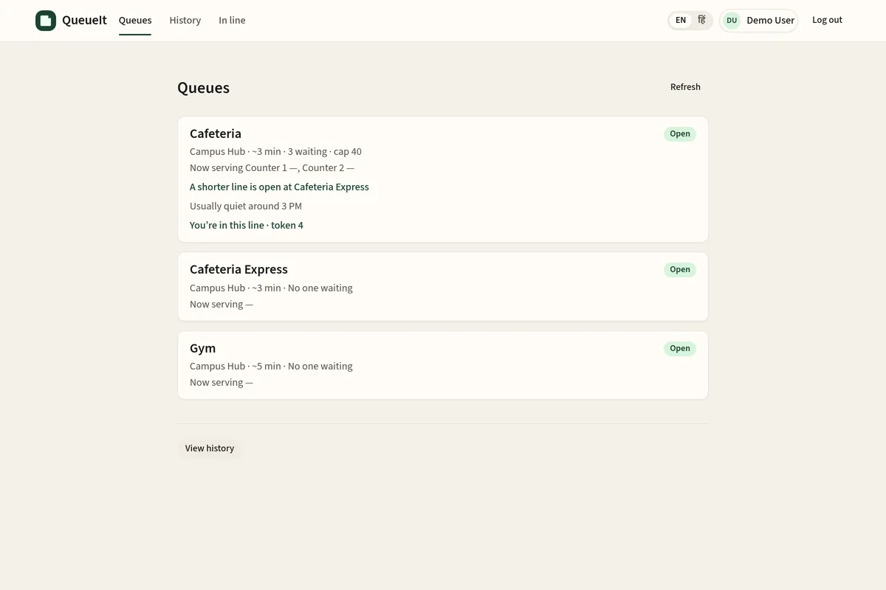
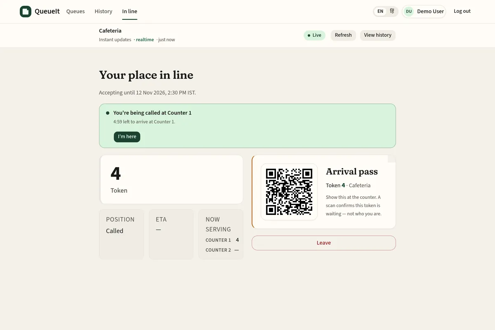
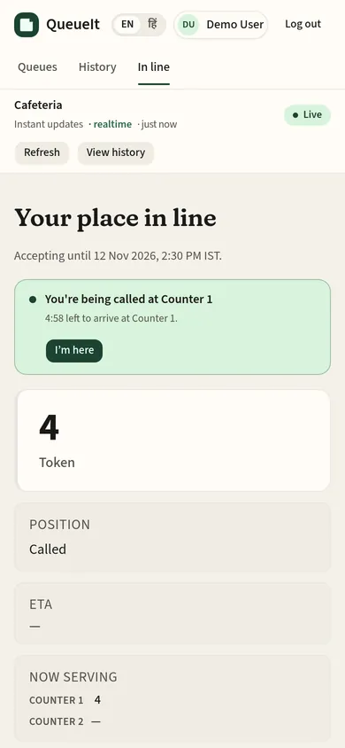
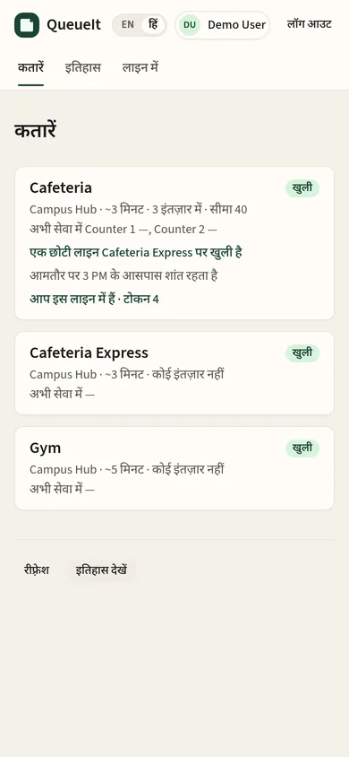
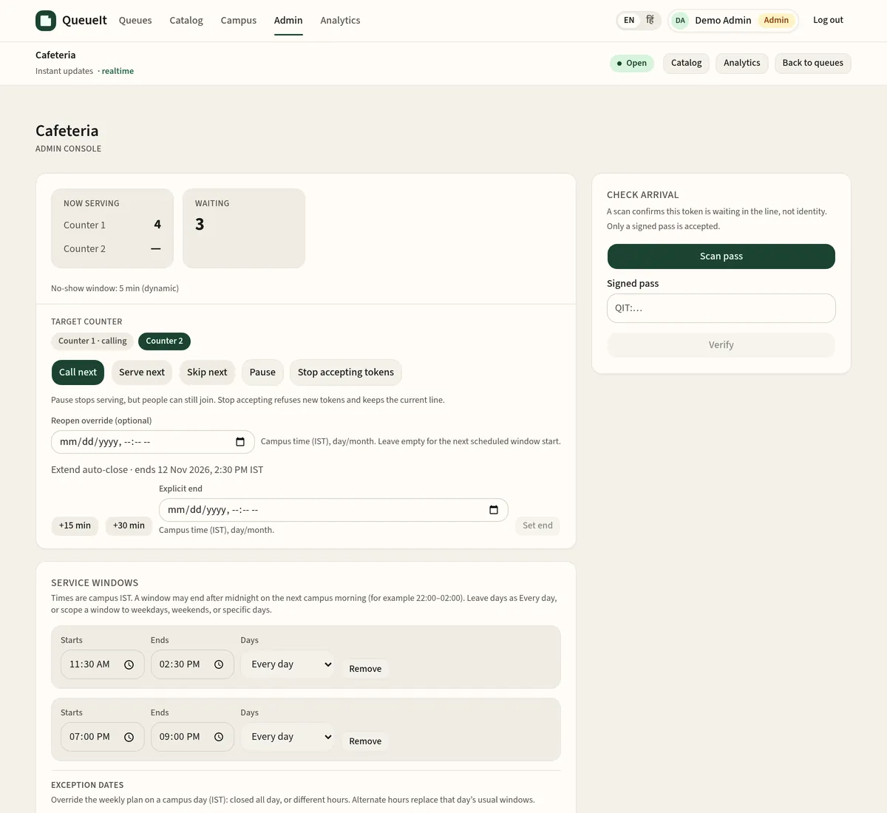
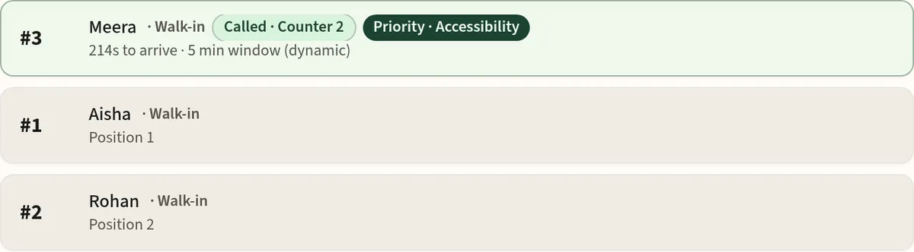
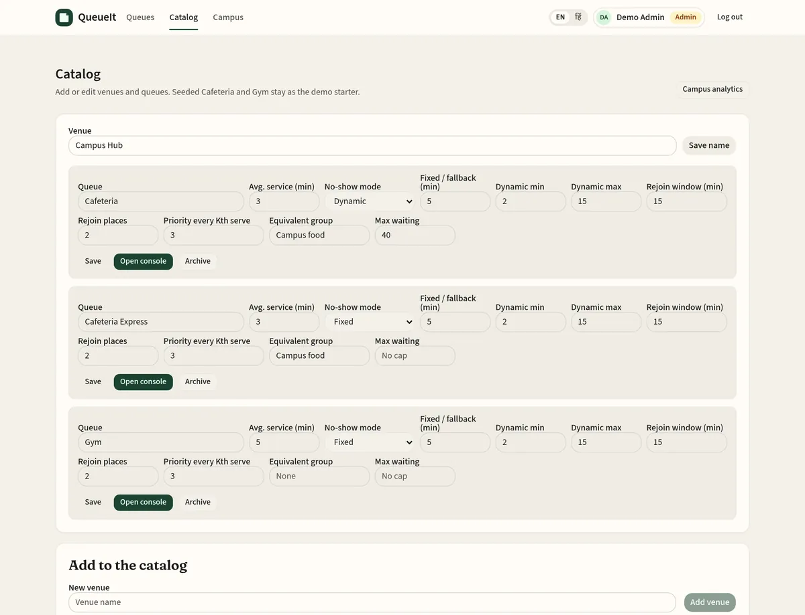
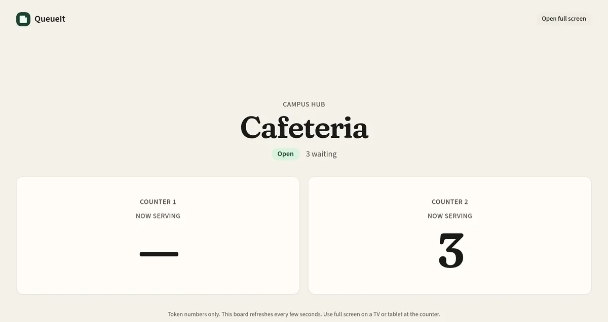
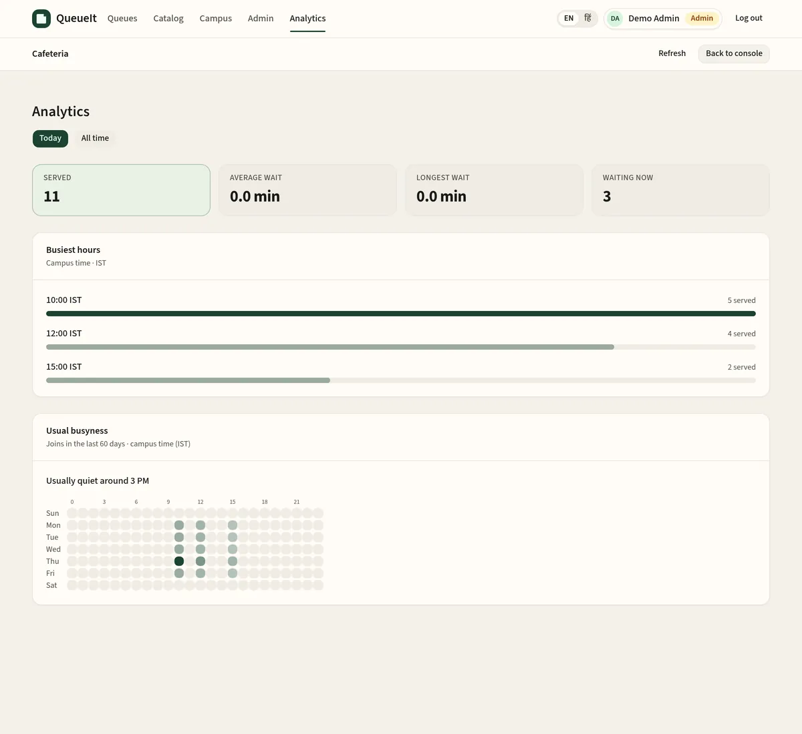
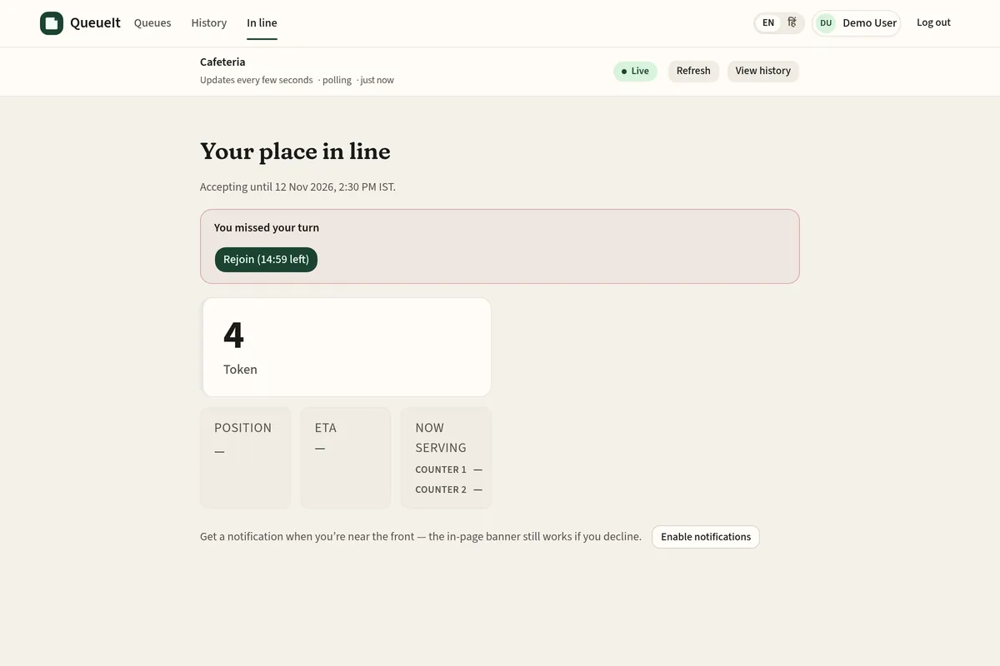

# QueueIt

Virtual queues for campus services. Students join a line from their phone, watch their place, and show up when it is their turn. Staff run the counter from an admin console — with multiple desks, signed arrival passes, and honest wait times in campus IST.

**Live app:** [queueit-seven.vercel.app](https://queueit-seven.vercel.app)



## Live deployment

| Surface | URL |
|---------|-----|
| Frontend | https://queueit-seven.vercel.app |
| Backend API | https://queueit-api.vercel.app |
| Health | https://queueit-api.vercel.app/api/health |

The production API is a Vercel serverless function, so the live app uses short polling rather than Instant updates. See [Deployment](#deployment).

## For students

- Browse a venue’s queues, or open a **poster join link** (`/join/:queueId`) from a printed QR — no need to visit the catalog first.
- Join with an account, or **continue as a guest**. Registering or logging in later moves the guest place and device history onto the account.
- See **token**, **position**, **ETA** (campus clock, IST), and **now serving**, including the counter when a queue has more than one desk.
- Get a **near-front** prompt in the next three, then a **called** banner with a countdown and an **I'm here** button when the counter calls you.
- Show a **signed arrival-pass QR** at the desk. The scan confirms that a token is waiting — not who the person is.
- Leave if plans change, and review **history** (portable after login).
- **Scan a poster or kiosk QR** to join without an account. The link opens in guest mode and explains that the place is saved on that phone. Admins can switch guest joining off per queue. Guest passes are limited to 2 places at once, pause after repeated no-shows, and are capped per network.
- **Light or dark theme.** It follows the device setting until you pick one in the header, and the choice is remembered.
- Use **English** (default) or **Hindi**. A header toggle is remembered on the device; a Hindi browser language can select Hindi first if no preference is stored. Admin copy stays English in this release.
- **Installable and offline-friendly.** QueueIt is a web app you can install (manifest, icons, standalone display; a small dismissible "Install app" card appears on browsers that support it). In production a service worker precaches the app shell for each build and keeps the last good catalog, place-in-line and status responses (network-first; sign-in and staff responses are never cached and the API marks them `no-store`). With no signal the status page keeps your ticket, position and an "as of" time under a clear offline banner, and resyncs on its own when you reconnect; joining or leaving while offline says so instead of failing. Each deploy ships a new worker; when it is ready a "New version available — Refresh" prompt switches over safely. It is not registered in Vite dev.







## For staff and admins

- **Waiting list** with call, serve, skip, pause, and resume. On a multi-counter queue, Call next can target a desk, and staff can still pick one explicitly.
- **Walk-in** tokens for people who arrive without the app.
- **Check arrival** — camera scan or a pasted signed pass (`QIT:…`). Only signed passes verify by default.
- **Catalog editor** — add, rename, or archive venues and queues without re-seeding. Set average service time, a **max waiting** cap (catalog shows Full; join and walk-in return 409 at capacity), no-show settings, missed-turn recovery, priority fairness, and an equivalent-queue group.
- **Service windows** in campus IST, including optional day-of-week scope, overnight windows (for example 22:00–02:00), and **holiday / exception** dates. Staff can start or stop accepting tokens, extend a session, and reset the line.
- **Poster QR** for the public join link (not an arrival pass), a **printable A4 poster** at `/admin/queues/:queueId/poster`, and a public **display board** at `/kiosk/:queueId` for a TV or tablet. The board shows a "Scan to join" QR while the queue takes tokens.
- **Analytics** at `/admin/analytics`:
  - date range of Today, 7 days, 30 days or custom dates (up to 92)
  - served per day, peak hours across 24 IST hours, average and 90th-percentile wait (join to call), and no-show rate per queue
  - CSV export of exactly that range
  - staff see only their venue and queues
  - API: `GET /api/admin/analytics/report` (`.csv`)

  Per-queue analytics add a 7×24 usual-busyness heatmap. No student names or emails are exported.
- **Audit log** — pause, resume, skip, serve, call, reset, start/stop accepting, window edits, staff invites, priority decisions, missed-turn rejoins, and queue setting changes, with who / what / when. Staff can only read logs for their venue. Events are paginated and expire after **90 days**.
- **Venue-scoped staff**, optionally limited to specific queues in that venue (an empty allow-list still means every queue there). A global admin can **invite staff** from the catalog (name, email, venue, optional queues, optional temporary password or a reset link) and later edit that allow-list. The seeded demo admin stays global.











## Dynamic queueing

- **Call + no-show timer** — calling someone starts a deadline (default 5 minutes, 1–30, admin-editable). **Fixed** mode always uses that window. **Dynamic** mode scales with recent arrival times, queue length, and counter pace, then clamps to admin min/max. Staff see the computed window. By default staff call the next person themselves; turn on **Call the next person after a no-show** per queue to have it happen when the grace period runs out (only while that counter is open).
- **I'm here** — a called student can check in from the status page. That flags the serving row for staff and **stops the no-show auto-skip** for that call. Staff can still serve or skip. The action is idempotent.
- **Missed-turn recovery** — a skipped (no-show) student can rejoin **once** within a per-queue window (default **15 minutes**). They are reinserted **N places behind** the current serving point (default **2**) without jumping people already in those places. A second miss is final, and anyone who manually left cannot recover. Staff see a **Returning** tag; the audit log records the rejoin.
- **No-show tracking** — the student's page says why they were skipped (grace period ran out, or staff skipped them) and how many turns they've missed. Anyone with **3 or more no-shows in 30 days** gets a **Frequent no-show** tag on their ticket in the staff console, a one-time `no-show-flag` entry in the audit log, and a row in the analytics **Frequent no-shows** table. Automatic no-shows are logged too, and analytics splits out the timed-out ones.



- **Priority lanes** — staff can mark a waiting person as priority (accessibility, pregnancy, medical/urgent, or other), and students can request the same for staff approval. Pending or rejected requests do not jump the line. At most every **Kth** serve may be priority (default **3**; **1** means no cap) so the regular line is not starved. Positions follow that fair order. Staff see a **Priority** tag; the audit log records marks, requests, and decisions.
- **Smart routing** — admins can group same-venue queues as **equivalent**. The catalog and join pages suggest a shorter open equivalent (“A shorter line is open at {name}”) without moving anyone automatically. Closed or full alternatives are not suggested. On a multi-counter queue, Call next is assigned to the idle counter that has waited longest, not always Counter 1.
- **Best time to come** — historical joins are bucketed by weekday and hour in campus **IST** (last 60 days). When there is enough variation, the catalog and join pages show “Usually quiet around X”; otherwise the student hint is hidden. A single stray arrival cannot become the quiet hour, and unobserved hours are never claimed. Admin analytics includes the 7×24 heatmap and the same hint, or “Not enough history yet”. No personal data is included in the busyness payload.

## Operations

**Live updates.** Polling backs student status and the admin waiting list. When the tab is visible and no socket is connected, it runs every **3 seconds**. When Socket.IO is connected it slows to **15 seconds** (the socket stays the fast path). Hidden tabs do not poll, and a refresh runs when the tab becomes visible again.

Instant updates need a **long-running API process** (`Socket.IO`). The Vercel serverless API cannot hold sockets, so production stays on the 3-second poll and never depends on realtime to work. The 15-second session closer also does not run on serverless; sessions still close lazily on the next request. Even on a long-running host, **guests keep polling** until guest socket auth exists — today’s handshake is JWT-only (`auth.token`).

**Notifications.** The status page can request the browser Notification permission and fire a one-shot alert when a student enters the top 3, becomes next, or is now serving. Polls do not re-notify the same state. Paused queues do not tell people to approach the counter. Optional sound and vibrate are user-controlled. On a closed catalog or join card, students can also ask to be notified when the queue starts accepting tokens again. That watch is stored in the browser and polled while this tab is open; there is no Web Push / VAPID in this release. Alerts only work while the QueueIt tab is open (including in the background). They do not arrive after the tab or browser is killed.

**Password reset.** The login page includes **Forgot password?**. `POST /api/auth/forgot-password` always returns a generic success message, so it does not reveal whether an email is registered. Reset tokens are stored as SHA-256 hashes, expire (default 60 minutes), and can be used only once. A successful `POST /api/auth/reset-password` sets the new password, invalidates the token, and signs the user in. In development, and whenever no mail transport is plugged in, the reset link is written to the server log (`[queueit-mailer] Password reset for …`) and the mailer does not throw. To send real mail later, set `SMTP_*` on the API host — do not commit secrets, and do not enable a paid provider by default.

**Arrival passes.** Join and status issue a signed pass (`QIT:<queueId>:<tokenNumber>:<mac>`), HMAC-SHA256 with `ARRIVAL_PASS_SECRET` or, if that is unset, `JWT_SECRET`. Admin verify accepts only a signed pass by default. A tampered MAC is rejected. Legacy unsigned `QIT:` passes and typed token numbers are rejected unless `ALLOW_UNSIGNED_ARRIVAL=1` is set on the API host.

**History** is paginated (default **20** events, max 50, newest first, `cursor` + `hasMore`). Admin analytics can be scoped with `?window=today` (campus IST day) or `from` / `to` ISO instants; waiting count stays live. The default (no query) is all-time.

## Architecture and stack

MongoDB, Express, React 19, Vite, Node, Tailwind / shadcn, JWT sessions (`user` | `admin`), and optional Socket.IO on a long-running API process.

```
.
├── client/          # React (Vite) frontend
├── server/          # Express API (HTTP routes, models, services, seed)
├── e2e/             # Playwright smoke + key-flow specs (incl. axe a11y)
└── package.json     # npm workspaces root
```

Visual tokens (palette, type, radius, elevation) are documented in [DESIGN.md](./DESIGN.md).

## Quick start

Prerequisites: Node.js 20+, npm 10+, and MongoDB (local `mongod`, Docker, or Atlas).

```bash
npm install

# Windows
copy server\.env.example server\.env
copy client\.env.example client\.env

# macOS / Linux
cp server/.env.example server/.env
cp client/.env.example client/.env
```

In `server/.env`:

1. Set `MONGODB_URI`.
2. Set a strong `JWT_SECRET`.
3. Set `SEED_*` emails and passwords for local demo accounts. Do not commit them.

Seed is idempotent. Re-running it updates demo account passwords, but does **not** overwrite live catalog names, service pace, no-show minutes, service windows, pause/closed state, or token counters. Set `SEED_RESET_CATALOG=true` only if you intentionally want default windows and `open` status restored:

```bash
npm run seed
```

| Venue | Queues |
|-------|--------|
| Campus Hub | Cafeteria (~3 min/serve), Gym (~5 min/serve) |

Two terminals. MongoDB must be reachable at `MONGODB_URI`.

```bash
# API — http://localhost:5000
npm run dev:server

# Client — http://localhost:5173
npm run dev:client
```

Health check: `GET /api/health` → `{"status":"ok","service":"queueit-server"}`.

Demo logins are **seeded from env**, not hard-coded in git. Use the `SEED_ADMIN_*` and `SEED_USER_*` values from your local `server/.env`. They are for **local development only**. Anyone can also register; new accounts are always `user`. Placeholder emails in `server/.env.example` (`admin@queueit.local`, `user@queueit.local`) are local templates — never commit real passwords, and do not publish production demo credentials in this repository.

## Environment

| File | Purpose |
|------|---------|
| `server/.env.example` | API host, database, secrets, seed, mail, and arrival-pass flags |
| `client/.env.example` | `VITE_API_URL` for the API base URL (no trailing slash) |

Copy the examples to `.env` locally. **Never commit `.env` or real secrets.**

### Server

| Variable | Purpose |
|----------|---------|
| `PORT` | API port (default `5000`) |
| `HOST` | Bind address (`0.0.0.0` on cloud hosts) |
| `NODE_ENV` | `development` or `production` |
| `MONGODB_URI` | MongoDB connection string (local `mongod` or Atlas) |
| `JWT_SECRET` | Required. Strong random signing secret |
| `JWT_EXPIRES_IN` | Optional token lifetime (`jsonwebtoken` format, default `7d`) |
| `ARRIVAL_PASS_SECRET` | Optional HMAC key for signed arrival passes; falls back to `JWT_SECRET` |
| `TOTP_ENCRYPTION_KEY` | Optional key that encrypts two-step sign-in secrets at rest; when unset a key is derived from `JWT_SECRET`. Changing either later means enrolled admins sign in with a backup code and enroll again |
| `ALLOW_UNSIGNED_ARRIVAL` | Optional. Set to `1` / `true` to accept legacy unsigned `QIT:` passes and typed token numbers at verify. Default off |
| `CLIENT_ORIGIN` | Exact frontend origin(s), comma-separated if needed |
| `SEED_ON_BOOT` | `true` to upsert demo accounts and the starter catalog on process start |
| `SEED_RESET_CATALOG` | `true` only to restore default windows and `open` status while seeding |
| `SEED_ADMIN_EMAIL`, `SEED_ADMIN_PASSWORD`, `SEED_ADMIN_NAME` | Local/demo admin account |
| `SEED_USER_EMAIL`, `SEED_USER_PASSWORD`, `SEED_USER_NAME` | Local/demo student account |
| `SESSION_CLOSE_INTERVAL_MS` | Long-running host only: how often to close expired sessions (default `15000`, minimum `1000`) |
| `PASSWORD_RESET_EXPIRES_MINUTES` | How long a reset link lasts (default `60`) |
| `GUEST_MINTS_PER_HOUR` | Optional. New guest passes allowed per network per hour (default `60`; campus Wi-Fi often shares one IP) |
| `TRUST_PROXY` | Optional. `1` / `0` to force Express `trust proxy`. Defaults to on when Vercel's `VERCEL` env is present |
| `SMTP_HOST`, `SMTP_PORT`, `SMTP_USER`, `SMTP_PASS`, `SMTP_FROM` | Optional mail transport. Unset by default — no paid provider is enabled, and reset links are logged instead |

### Client

| Variable | Purpose |
|----------|---------|
| `VITE_API_URL` | Public API base URL at **build** time (no trailing slash). Local default: `http://localhost:5000` |

CORS rejects browser calls if `CLIENT_ORIGIN` does not match the site origin exactly (scheme + host + port).

### Sign-in security

- **Two-step sign-in (admin and staff, opt-in).** Under *Account security* (click your name in the top bar) an admin or staff member confirms their password, scans a QR code with any authenticator app (TOTP, 6 digits, 30 s), confirms one code, and gets 10 one-time backup codes. Sign-in then asks for a code after the password; each code works once. Turning it off or making new backup codes needs a current code. Seeds are AES-256-GCM encrypted at rest; backup codes are stored only as hashes. Nobody is enrolled by default, so existing logins keep working, and a password reset never skips the code step.
- **Sign out of all devices.** Every account can end all its sessions at once. Session tokens carry a token version; bumping it rejects every older token (REST and Socket.IO). Password resets bump it too. Older user records without the field count as version 0, so existing tokens stay valid until someone uses it.
- **Lockout.** Failed sign-ins (password or code) are counted per account and per IP in MongoDB, so the limit holds across serverless instances: 5 failures in 15 min lock the account for 15 min, 30 lock the IP. A locked attempt gets the same "Too many attempts, try again later" as the rate limiter, and unknown emails behave exactly like real ones (same errors, same bcrypt cost), so neither reveals whether an account exists. Counters store only hashes and expire on their own. On top of that, each instance rate-limits failed sign-ins per IP (10 per 15 min) and the shared auth limiter still caps register/login/reset traffic.
- **Password reset links** are random 256-bit tokens stored as SHA-256 hashes, expire after `PASSWORD_RESET_EXPIRES_MINUTES` (default 60), work once, and requesting a new one retires the old one. Using one signs out every other session and clears any lockout.
- **Audit log.** Turning two-step sign-in on or off, new backup codes, sign-out of all devices and lockouts appear under *Sign-in and security* in the audit log (global admins).
- **Headers.** The API sends Helmet defaults plus a deny-all CSP (it only serves JSON), `no-referrer`, and `Cache-Control: no-store` on auth and admin routes. The web app (`client/vercel.json`) sends a CSP that allows only its own scripts (plus a hash for the inline theme script in `index.html` — update it if that script changes; a unit test checks it), its own service worker and manifest, and the API at `https://queueit-api.vercel.app` (change `connect-src` if `VITE_API_URL` changes), plus `X-Frame-Options: DENY`, `nosniff`, a strict referrer policy and a Permissions-Policy that only allows the camera for QR scanning.

The API also applies a 16kb JSON body cap and per-IP rate limits on `POST /api/auth/login`, `POST /api/auth/register`, `POST /api/auth/forgot-password`, `POST /api/auth/reset-password`, and `POST /api/queues/:id/join`. Register and login reject invalid emails, passwords outside 8–128 characters (register also enforces a minimum of 8), and names longer than 80 characters. Do not set `trust proxy` unless the process is behind a known reverse proxy; rate limits are keyed by the direct client IP.

Guest credentials are minted as high-entropy secrets and returned once to the device. Mongo stores only a SHA-256 hash. The browser keeps the raw guest credential and JWT in `localStorage`, which is convenient on this device but means any XSS can steal the session. Prefer fixing XSS over treating `localStorage` as a vault; moving to httpOnly cookie sessions would be a separate migration.

## Scripts

| Script | Description |
|--------|-------------|
| `npm run dev:server` | Express with file watch |
| `npm run dev:client` | Vite dev server |
| `npm run start:server` | Express production start |
| `npm run build:client` | Production client build |
| `npm run seed` | Upsert demo accounts + Campus Hub / Cafeteria / Gym |
| `npm run seed:e2e` | Wipe + seed dedicated `queueit-e2e` DB |
| `npm test` | Server HTTP API tests + client unit tests |
| `npm run lint` | ESLint for client and server |
| `npm run test:e2e` | Playwright: smoke and key flows (student join/leave, guest QR join, admin call/serve, analytics + CSV, poster/kiosk, dark mode, keyboard, axe WCAG AA in both themes) |
| `npm run test:e2e:smoke` | Only the smoke specs |

`npm test` runs the server HTTP API suite and the client unit tests (`client/src/lib/*.test.js`). Server tests use in-memory MongoDB (`mongodb-memory-server`); no local `mongod` is required.

`npm run lint` runs ESLint over the client and server (ESLint 9). Playwright is a separate, manual job because it needs local MongoDB. The e2e script **wipe-seeds** only `queueit-e2e` (never the developer `queueit` database), then starts API `:5000` and Vite `:5173`. Artifacts (gitignored): `playwright-report/index.html`, failure traces under `test-results/`.

## Deployment

Suggested free-tier path: MongoDB Atlas + a Vercel API from `server/` + a Vercel frontend from `client/`.

### 1. MongoDB Atlas

1. Create a free cluster and database user.
2. Network access: allow the API host (or `0.0.0.0/0` if you accept that tradeoff).
3. Set the `mongodb+srv://…` URI only on the API host as `MONGODB_URI`.

### 2. Backend (Vercel from `server/`)

```bash
cd server
vercel --prod
```

Set on the project: `MONGODB_URI`, `JWT_SECRET`, `CLIENT_ORIGIN` (set after the frontend URL is known — redeploy the API if needed), and, for a first demo seed, `SEED_ON_BOOT=true` plus the `SEED_ADMIN_*` / `SEED_USER_*` values. Optional: `ARRIVAL_PASS_SECRET`, `ALLOW_UNSIGNED_ARRIVAL`, `SEED_RESET_CATALOG`, `JWT_EXPIRES_IN`, `SMTP_*`, `PASSWORD_RESET_EXPIRES_MINUTES`.

Confirm: `GET https://<api-host>/api/health` → `{"status":"ok","service":"queueit-server"}`.

After the first successful seed, set `SEED_ON_BOOT=false` so restarts only serve traffic. Seeding is idempotent and no longer overwrites admin-edited catalog fields; use `SEED_RESET_CATALOG=true` only for an intentional demo reset.

### 3. Frontend (Vercel from `client/`)

```bash
cd client
vercel --prod
```

Build env: `VITE_API_URL=https://<your-api-host>` (must be present **at build time**). Then set API `CLIENT_ORIGIN` to the production frontend origin and redeploy the API if CORS was wrong on first boot.

### Vercel polling vs a long-running host

The live production API at `queueit-api.vercel.app` is a Vercel **serverless** function (`server/api/index.js`). That path is fine for HTTP (join, status, admin, polling). It cannot hold WebSocket connections, so the production app stays on “Updates every few seconds,” and the 15-second session closer in `server/src/index.js` does not run there (lazy close still happens on the next request).

Instant updates (`Socket.IO`) and punctual auto-close need a **long-running Node process** that starts `server/src/index.js` (`npm start` in `server/`, or `npm run dev:server` locally). This is already how local development works.

This is a plan, not a production cutover. Do not move DNS, buy a paid plan, or copy production secrets in a drive-by change. The serverless entry should stay deployed and working with polling until an operator chooses to switch `VITE_API_URL` or DNS.

What will not work on Vercel serverless:

- **Socket.IO** (“Instant updates”)
- The 15-second `SESSION_CLOSE_INTERVAL_MS` closer
- Web Push fan-out (see [Roadmap and known limits](#roadmap-and-known-limits))

Polling remains the fallback everywhere and is enough for the product to work. **Guests poll until guest socket auth exists**, including on a long-running host.

Any host that can run a persistent Node process and reach MongoDB is enough (a campus VM, a VPS, Render as a web service, Fly.io, and similar). Point the process at `npm start` with the working directory `server/`. Put a TLS reverse proxy in front if the host does not terminate HTTPS. Set the same API variables as production on that host only, including `CLIENT_ORIGIN`, and build the client with `VITE_API_URL` pointing at the long-running origin.

When you are ready: provision the host, confirm `GET /api/health`, confirm a logged-in user sees Instant updates, then change `VITE_API_URL` (and DNS if you use a custom API domain) and redeploy the client. Leave the Vercel API up until that is verified. Paid plans, DNS, and production secrets stay with the operator.

### Smoke the live path

1. Open the frontend and log in as the seeded **user**.
2. Join a queue and confirm token, position, ETA, and now serving.
3. In another browser or profile, log in as the seeded **admin** and serve / skip / pause-resume.
4. Confirm the user view updates within a few seconds.

Keep `.env` files gitignored. This README must not contain production passwords or Atlas credentials.

## Roadmap and known limits

- Instant updates and punctual session close need a long-running API host; production Vercel stays on polling and lazy close.
- Guest Socket.IO auth is not implemented. A later design could issue a hashed, membership-scoped device credential for the handshake. Until that ships, guests poll.
- True push-when-the-app-is-closed needs Web Push (VAPID keys, a service worker `push` handler, and a server that holds subscription endpoints). That would require a long-running API host and secrets that must never be committed. This release does not implement it.
- The arrival-pass QR is a counter convenience, not proof of identity. The kiosk board is public and shows token numbers only — no PIN gate in this release.
- Admin UI copy is English-only in this release.
- Runtime API packages are pinned past known advisories. `npm audit --omit=dev` is clean. Remaining `npm audit` findings live in dev/CLI trees, not the production server or client bundle.
